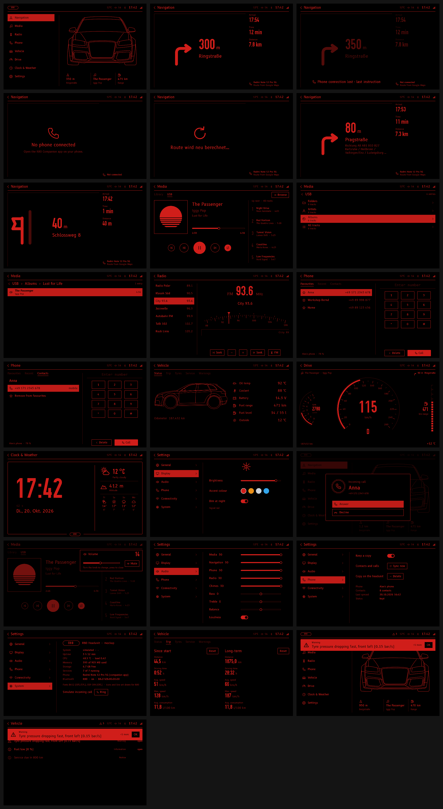

# Project R80

A headunit (hardware and software) and centre console for a modified
2005 Audi A3 Sportback (8PA, PQ35 platform).

Current state: the headunit software runs without target hardware, on a Linux PC and on
a Raspberry Pi bench: services for vehicle data, media (Library, USB sticks, music from
the phone), audio, warnings and trip computer, navigation guidance from the driver's phone
(with the R80 Companion Android app), hands-free calls and the phone's contacts, and
system settings, under the line-art UI. The car is simulated with a made-up test CAN
database and [BoAt](https://github.com/AlexTech-stack/BoAt); CI runs the BoAt tests on
every push. Real bus logs and the hardware designs come later.

## One headunit, three run modes

All of them start with [`./r80`](r80) (`./r80 --help`):

| Mode | What runs | Where |
|---|---|---|
| `./r80 demo` | only the UI, on fake data; no services | any PC with PySide6, Qt Design Studio |
| `./r80 virtual <cmd>` | the whole headunit; the MCU and the phone are emulated, BoAt plays the car | a Linux PC with vcan and BoAt |
| `./r80 bench <cmd>` | the whole headunit on a Raspberry Pi; CAN tunnelled from the PC | the Pi bench, see [`docs/bench-pi.md`](docs/bench-pi.md) |



## Folders

| Folder | What is in it |
|---|---|
| [`hu/`](hu/) | The headunit software, the same in every mode: the D-Bus services (`hu/services/`: `vehicled`, `mediad`, `audiod`, `warnd`, `tripd`, `navd`, `sysd`) and the Qt 6 / QML UI (`hu/ui/`, 1280 x 768, PySide6). See [`hu/ui/README.md`](hu/ui/README.md). |
| [`hu-can/`](hu-can/) | Test CAN database (`r80_test.dbc`, classic CAN, 22 messages), generator and drive simulator, sample candump log. |
| [`dev/`](dev/) | PC stand-ins for the virtual mode: MCU emulator, phone emulator and phone panel, and `hu-virtual.sh`. See [`dev/README.md`](dev/README.md). |
| [`test/boat/`](test/boat/) | BoAt restbus node, tester panel and the BoAt tests. |
| [`bench/pi/`](bench/pi/) | Raspberry Pi 3B bench files: cannelloni CAN tunnel, kiosk launcher, systemd units and their installer, internet sharing from the test PC. |
| [`companion-android/`](companion-android/) | R80 Companion, the Android app on the driver's phone: sends the phone's navigation guidance to the HU (decision D11). |
| [`docs/`](docs/) | [Architecture](docs/architecture/) (v0.3, decisions D1 to D13), [bench guide](docs/bench-pi.md), [companion protocol](docs/companion-protocol.md), [screenshots](docs/screenshots/). |
| [`ci/`](ci/) | CI scripts. GitHub Actions runs them on every push; run `ci/check_static.sh` locally for the same checks. |
| [`hardware/`](hardware/) | Placeholder for hardware designs (PCBs, console). Licensed CERN-OHL-P-2.0. |

## For coding agents

Rules for AI coding agents are in [`AGENTS.md`](AGENTS.md); [`CLAUDE.md`](CLAUDE.md) imports it and adds Claude-specific notes.

## Quick start

```bash
python3 -m pip install PySide6 cantools python-can
./r80 demo                                        # the UI in a window, fake data
./r80 demo screenshots /tmp/shots                 # render every screen headless
python3 hu-can/tools/r80_can_sim.py --log drive.log
```

## Licences

- **Software** (everything outside `hardware/`): MIT, see [`LICENSE`](LICENSE).
- **Hardware designs** (`hardware/`: schematics, PCB layouts, console CAD):
  CERN Open Hardware Licence v2 Permissive, see [`hardware/LICENSE`](hardware/LICENSE).
- **Fonts** in `hu/ui/fonts/` keep their own licences (B612: OFL/EPL, OSP-DIN: OFL),
  see the licence files next to them.
- Map data (OpenStreetMap, ODbL) is not stored in this repository.

The brand mark in the UI is a placeholder ("R80"). Swap `hu/ui/qml/Logo.qml` if you want something else.
