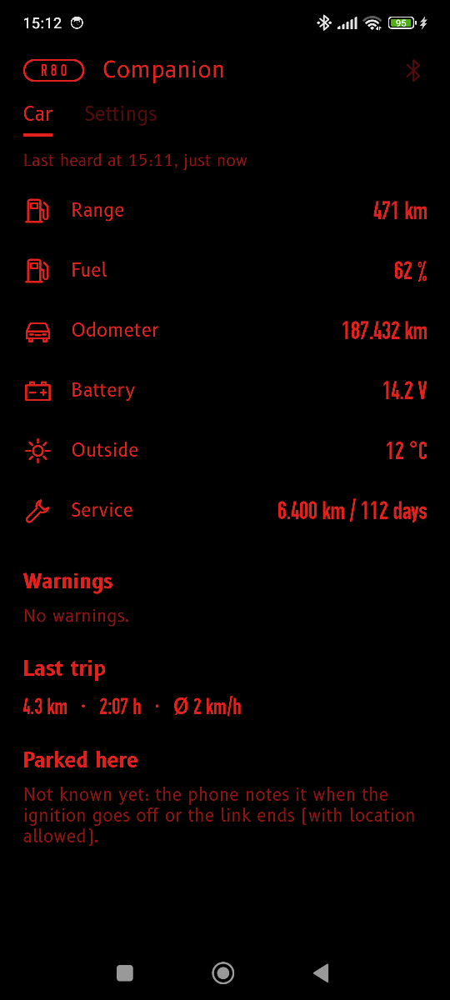
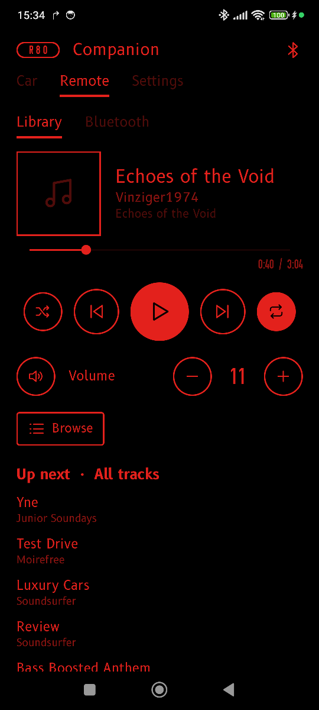

# R80 Companion (Android app)

The app on the driver's phone (decision D11): the phone navigates, the headunit
displays. The app reads the turn-by-turn guidance of Google Maps' navigation
notification and sends it to the HU over the companion link
([`../docs/companion-protocol.md`](../docs/companion-protocol.md)). It also brings the HU
the weather and the altitude, keeps how the car was parked for when the driver is away
from it, and is a remote for the passenger. It looks like the HU (below).

| Car | Remote |
|---|---|
|  |  |

Android 14 or newer, Kotlin, no Google Play services, MIT like the rest of R80.

## What it does

- **Reads Google Maps:** distance to the next maneuver, road, and remaining time
  and distance are text in the notification. The maneuver itself is only in the
  arrow image. The app turns that image into a small fingerprint and looks it up
  in [`app/src/main/assets/maneuver_icons.json`](app/src/main/assets/maneuver_icons.json):
  19 Google Maps arrows (turns of every strength, U-turn, forks, motorway exit,
  merge, roundabout right / straight / left, destination and its side), built from
  captured virtual drives in Pforzheim, Stuttgart and Karlsruhe. Only fingerprints
  are stored, never Google's images. An arrow that is not in the table yet reaches
  the HU as maneuver `unknown` with distance and road (generic arrow); capture
  mode records it, so it can be added.
- **Link to the HU:** Bluetooth RFCOMM to the paired HU (hu-navd registers the
  companion service with BlueZ and only accepts paired phones). For development
  also Wi-Fi: TCP to a PC running `hu-navd --tcp 47800` (trusted network only, no
  authentication). The link reconnects by itself and runs as a foreground
  service, so Android keeps it alive during a drive.
- **Weather and altitude for the HU:** the phone's position from Android's own location
  service (no Google library), the altitude above sea level from it (Android 14's
  `AltitudeConverter`), the weather there from [open-meteo.com](https://open-meteo.com)
  (free, no key, data CC BY 4.0; the position rounded to about 1 km). The HU shows them on
  its Clock & Weather screen. The HU never gets the coordinates. Settings → "Weather and
  altitude" switches it off.
- **Car (tab):** the HU tells the app how the car is (fuel, range, odometer, battery,
  outside temperature, service, warnings, the trip) every minute and when the ignition goes
  off. The app keeps the last state and, when the ignition goes off or the link ends, the
  phone's position as "Parked here" (with "Open in maps"). The position stays on the phone.
  Warnings still open at ignition off become a notification.
- **Remote (tab):** for the passenger with the driver's phone: what plays on the HU, the
  sources, play / pause / next / previous / seek / shuffle / repeat, the master volume and
  mute, up next, and browsing the HU's library (folders, artists, albums, all tracks) to
  play from any list. Only while the HU allows it (on the HU: Settings → Phone → "Remote
  from the app", on by default); otherwise it only shows. No covers yet.
- **The look:** black, line art in the HU's accent colour (the HU tells it), the HU's fonts
  (B612, OSP-DIN: taken from [`../hu/ui/fonts`](../hu/ui/fonts) as the app's assets, with
  their licence files) and the HU's icons (`res/drawable/hu_*.xml`, generated from
  [`../hu/ui/qml/Icons.qml`](../hu/ui/qml/Icons.qml) by `tools/make_icons.py`;
  `ci/check_static.sh` fails when they are out of date). Keep it that way: new icons go
  into Icons.qml and the generator's list, not into the app.
- **Capture (development):** records every Google Maps notification (all text
  fields, the arrow's fingerprint) and each different arrow image once. "Export
  to Downloads" saves a zip. The recording contains the streets of the drive and
  stays on the phone until you export or delete it.

## Install and set up

1. Get the APK: CI job `android`, artifact `r80-companion`
   (`r80-companion-debug.apk`), or build it yourself (below).
2. Install it on the phone (allow installing from that source).
3. Open the app → "Open notification access" → enable R80 Companion. Android 13+
   greys this out for apps not installed from a store: App info → ⋮ → "Allow
   restricted settings", then try again.
4. Allow notifications, "Nearby devices" and location when asked (the foreground service
   shows a notification; "Nearby devices" lets the app list the paired HU; location is for
   the weather, the altitude and where the car is parked).
5. Settings tab: choose the HU, Connect. From then on the app connects again whenever it
   is opened (until Disconnect).

CI signs every build with the same debug key (the repository secret
`ANDROID_DEBUG_KEYSTORE`, a base64 PKCS#12 keystore, alias `androiddebugkey`,
password `android`, as Android's own debug key), so a newer APK from CI installs as an
update (`adb install -r`) and keeps the app's settings. Without the secret (a fork) each
build gets a new key: uninstall first. A local build signs with your own debug key.

## Try it with the virtual HU

**Over Bluetooth** (the PC plays the HU; it needs a Bluetooth adapter):

1. Pair the phone with the PC (the PC's Bluetooth settings, or `bluetoothctl`).
2. Start the virtual HU with the PC's real Bluetooth:
   ```bash
   NAV_BLUETOOTH=system ./r80 virtual up && ./r80 virtual ui      # from the repo root
   ```
   `$XDG_RUNTIME_DIR/r80-hu/navd.log` should say "companion service registered with BlueZ".
3. In the app: Bluetooth, choose the PC, Connect, then start a route in Google Maps.

**Over Wi-Fi** (phone and PC in the same network; the PC's firewall must allow TCP 47800):

```bash
NAV_ARGS="--tcp 47800" ./r80 virtual up && ./r80 virtual ui       # from the repo root
```

In the app: Wi-Fi (development), enter `<PC's IP>:47800`, Connect.

Either way the HU's Navigation screen follows the route.

## Build

```bash
ci/build_android.sh          # unit tests + debug APK into build/ci/android/
```

Needs JDK 21, Gradle 9.8 and the Android SDK (`ANDROID_HOME`); Android Studio
brings the SDK and can open `companion-android/` directly. The unit tests run on
the PC (no phone): the protocol against
[`../docs/companion-protocol-examples.jsonl`](../docs/companion-protocol-examples.jsonl)
(the HU checks the same file in TC_HU_020), the Maps parser, the arrow
fingerprints, the link against a fake HU, open-meteo's answer, the car store.

## Files

```
app/src/main/java/de/r80/companion/
  Protocol.kt             companion link protocol v1 (phone side)
  Link.kt                 session: hello, guidance, heartbeats, reconnect; TCP transport
  BluetoothTransport.kt   RFCOMM to the paired HU
  MapsParser.kt           Google Maps notification text -> Guidance
  IconTable.kt            arrow image fingerprints -> maneuver
  MapsListenerService.kt  notification listener; capture hook
  LinkService.kt          foreground service holding the link
  Capture.kt              capture mode and export
  Surroundings.kt         position, altitude and the weather (open-meteo) for the HU
  CarStore.kt             the last car_status and where the car was parked (on the phone)
  RemotePage.kt           the Remote tab
  Hu.kt                   the HU's look: accent colours, fonts, icons, buttons, tabs, rows
  MainActivity.kt, Settings.kt, AppState.kt   screen (header, tabs Car | Remote | Settings), settings, shared state
app/src/main/assets/maneuver_icons.json        known arrows (built from captures)
app/src/main/res/drawable/hu_*.xml             the HU's icons (generated, do not edit)
app/src/test/                                  JVM unit tests
tools/make_icons.py                            Icons.qml -> hu_*.xml (needs PySide6)
```
