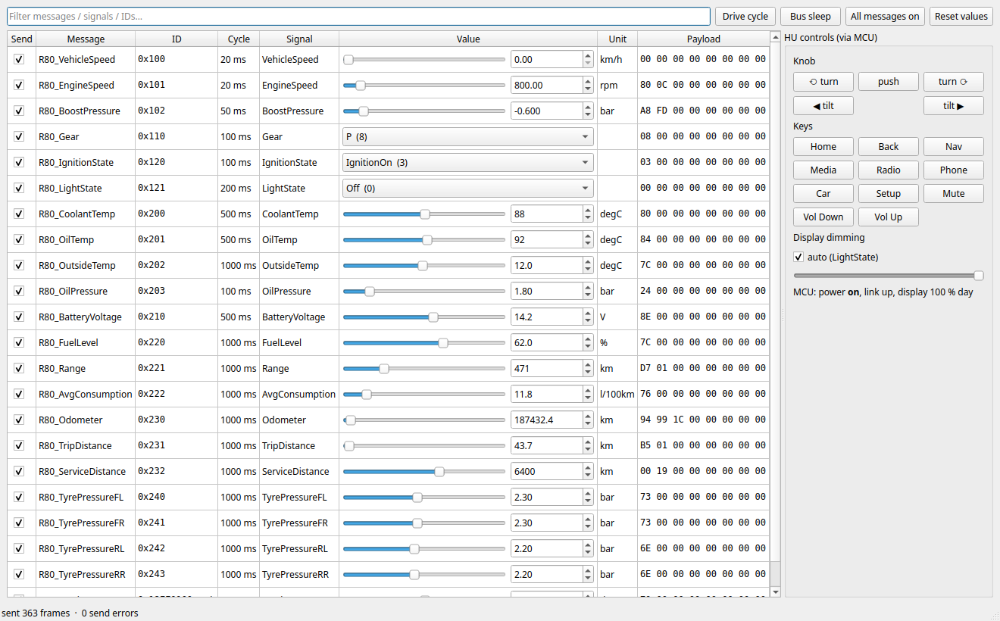
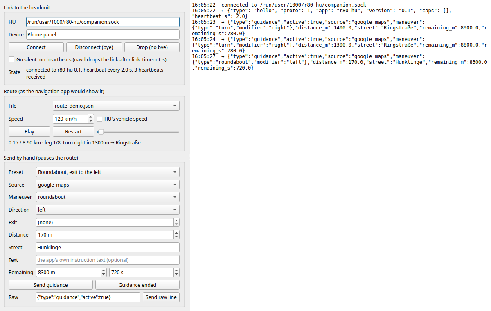

# Virtual mode: the R80 headunit without target hardware

`./r80 virtual <command>` (`dev/hu-virtual.sh`) runs the headunit software (`hu/`) on a Linux PC, with the car simulated by BoAt on
virtual CAN buses and the vehicle MCU replaced by an emulator process.

```
 BoAt (gateway :50061)                      "the headunit"
 ┌──────────────────────┐   vcan_info    ┌───────────────┐  UART (pty)  ┌──────────────┐  D-Bus   ┌────────────┐
 │ restbus.py  (R80 DBC)├───────────────►│ mcu_emu.py    ├─────────────►│ vehicled     ├─────────►│ hu/ui      │
 │ tests/*.py           │   vcan_motor   │ power, knob,  │◄─────────────┤ DBC decode   │          │ (live      │
 │ boat test run        │  (CAN 2, listen│ dimming, CAN  │              │ de.r80.Vehicle│         │  backends) │
 └──────────────────────┘   only)        └───────────────┘              └──────────────┘          └────────────┘
          ▲  mcuctl.py (knob, buttons, dim override) ────┘
 
 mediad.py (GStreamer)    ── D-Bus de.r80.Media ─────────────────────────────────►│ Media screen │
 ```

| Part | Real car / bench | Virtual |
|---|---|---|
| CAN buses | Motor, Infotainment, Comfort | `vcan_motor`, `vcan_info`, `vcan_comfort` (SocketCAN) |
| Rest of the car | real ECUs | BoAt gateway + `test/boat/restbus.py` playing `hu-can/r80_test.dbc` |
| Vehicle MCU, CAN 1 active on Infotainment, CAN 2 listen-only (D8) | MCU on the HU board | `dev/mcu_emu/mcu_emu.py` (same UART protocol), CAN 2 on `vcan_motor` by default |
| MCU ↔ Linux | UART, e.g. `/dev/ttyAMA0` | pty, symlinked at `$XDG_RUNTIME_DIR/r80-mcu-uart` |
| Knob / buttons | MCU pins | `dev/mcu_emu/mcuctl.py` over a control socket |
| Linux vehicle service | `hu/services/vehicled.py --system --uart /dev/ttyAMA0` | `hu/services/vehicled.py` (session bus) |
| Linux media service | `hu/services/mediad.py --system --music-dir /media/usb` (GStreamer) | `hu/services/mediad.py` (session bus, demo tones unless `MUSIC_DIR` is set) |
| Other HU services | `audiod` (audio, D9), `warnd` and `tripd` (D10), `navd` (D11), `sysd` (system and settings, D12), all with `--system` | the same files on the session bus |
| Driver's phone | R80 Companion app over Bluetooth (D11) | `dev/phone_emu/`: a route player and the phone panel |
| UI | Qt 6 / QML, `hu/ui/run.py` (live) | the same |

Everything under `hu/` is target software and has no BoAt dependency; it runs
unchanged on the Pi. `dev/` and `test/boat/` exist only for the PC. Paths in this
file are from the repo root; run the commands there.

## Run it

Needs: [BoAt](https://github.com/AlexTech-stack/BoAt) built at `~/BoAt` (or `BOAT_ROOT=`), Python 3 with PySide6,
dbus-python, PyGObject and the GStreamer 1.0 bindings (`python3-gi` + `gst-plugins-base`/`-good`),
and `sudo` once to create the vcan buses. No cantools or python-can.

```bash
./r80 virtual drive      # buses, gateway, MCU emulator, all HU services, restbus drive cycle
./r80 virtual ui         # the UI window on top (UI_ARGS="--fullscreen" etc.)
./r80 virtual status
./r80 virtual down
```

### Tester panel

```bash
./r80 virtual up
./r80 virtual panel      # instead of `drive`: the panel is the restbus
./r80 virtual ui
```



`test/boat/restbus_panel.py` sends every message of `hu-can/r80_test.dbc` through
the BoAt gateway at its cycle time, like `restbus.py`, and lets a tester:

- set any signal live: slider or spin box on the signal's own resolution, enums
  as drop-downs, with the resulting payload bytes shown per message,
- untick **Send** to drop one message (the HU flags it stale), or press
  **Bus sleep** to stop the whole bus (the MCU shuts the HU down),
- hand speed, rpm, gear, odometer, fuel, … to the **Drive cycle** and take them
  back; the other signals stay editable while it runs,
- operate the controls wired to the MCU: knob turn / push / tilt, the hard
  keys and the dimming override.

Ranges, enums and units come from the DBC itself (not from BoAt's PDU JSON,
whose min/max are wrong up to BoAt v0.1.1; AlexTech-stack/BoAt#11, fixed on master).

Poke it from the command line while it runs:

```bash
python3 dev/mcu_emu/mcuctl.py knob 1           # turn (-1 = back)
python3 dev/mcu_emu/mcuctl.py push
python3 dev/mcu_emu/mcuctl.py button NAV       # HOME BACK NAV MEDIA RADIO PHONE CAR SETUP VOL_UP VOL_DOWN MUTE
python3 dev/mcu_emu/mcuctl.py dim 30           # or "auto"
python3 dev/mcu_emu/mcuctl.py status
gdbus call --session -d de.r80.Vehicle -o /de/r80/Vehicle \
  -m org.freedesktop.DBus.Properties.GetAll de.r80.Vehicle1
candump -a vcan_info
RESTBUS_ARGS="--lights LowBeam" ./r80 virtual restbus   # night mode (stop the drive one first)
MCU_CAN2=vcan_comfort MCU_CAN2_BUS=comfort ./r80 virtual up   # CAN 2 on Comfort instead of Motor
```

The UI falls back to the mockup's own fake data whenever hu-vehicled or the
MCU link is not there, so `hu/ui/run.py` also works on its own.

## Media (hu-mediad)

`hu/services/mediad.py` is the Linux media service: it scans a folder for audio files
(the USB / SD-card source) and plays them with GStreamer `playbin`, publishing
on D-Bus `de.r80.Media` at `/de/r80/Media` (interface `de.r80.Media1`):

- properties `PlaybackStatus`, `Source`, `Sources`, `TrackIndex`, `TrackCount`,
  `Position` (µs), `Metadata`, `Playlist`, `Shuffle`, `RepeatAll`, `CanGoNext`,
  `CanGoPrevious`
- methods `Play`, `Pause`, `PlayPause`, `Next`, `Previous`, `SetTrack`, `Seek`,
  `SetPosition`, `SetPlaying`, `SetShuffle`, `SetRepeatAll`, `SetSource`,
  `SetGain(gain, fade_ms)` (the playback level, set by hu-audiod)
- signals `Seeked` and `PropertiesChanged`

`./r80 virtual up` starts it on a demo folder of short WAV tones. Point it at
your own library with `MUSIC_DIR` (then no tones are written), or pass extra
flags with `MEDIA_ARGS`:

```bash
MUSIC_DIR=~/Music ./r80 virtual up
MEDIA_ARGS="--music-dir /media/usb --sink fakesink" ./r80 virtual up
gdbus call --session -d de.r80.Media -o /de/r80/Media -m de.r80.Media1.Next
gdbus call --session -d de.r80.Media -o /de/r80/Media \
  -m org.freedesktop.DBus.Properties.Get de.r80.Media1 Metadata
```

Title / artist come from the file name (`Artist - Title.ext`), the album from
the folder, and the duration is learned once GStreamer prerolls the track.
Bluetooth A2DP and MPRIS are not wired up yet. `hu/ui/qml/Sim.qml` binds the
Media screen to this service and falls back to the mockup's own playlist when
`hu-mediad` is not on the bus, so `hu/ui/run.py` still works alone.

## Audio (hu-audiod)

`hu/services/audiod.py` owns volume and mute (decision D9), on D-Bus `de.r80.Audio` at
`/de/r80/Audio` (interface `de.r80.Audio1`):

- properties `Max`, `Master`, `Muted`, `StartupCap`, `Volumes` (per source:
  media, navigation, phone, radio), `Gains` (the level each source should play at),
  `NavPrompt`, `CallState` (idle / ringing / active), `Duck`, `Chime`,
  `WarningChimeGain`; sources are media, navigation, phone, radio and chime
- methods `SetMaster`, `Step`, `SetMuted`, `ToggleMute`, `SetVolume(source, value)`,
  `SetNavPrompt(active)`, `SetCallState(state)`, `SetChime(active)`

For each source it computes `gain = ((Master / Max) * (Volume / Max)) ** curve`
(0 while muted) and the source applies it itself: `mediad` through `SetGain`,
with a GStreamer `volume` element, so PipeWire's own stream volume is never
touched. Every change is a linear ramp of `change_fade_ms` (audio.ini, 50 ms),
computed per sample by GStreamer's controller, because a jump clicks. The
`volume` element sits right in front of the audio sink (not in playbin's
`audio-filter` slot, where it ran about 1.3 s ahead of what was heard), and the
sink buffer is 60 ms (`mediad --buffer-ms`): a change is audible about 60–90 ms
later. Track changes, seeks and pause/resume fade out and in the same way
(the new title and status show at once; the audio follows after the fade), since
stopping or jumping mid-waveform clicks too. `--demo` also replaces outdated demo
tones, but only in a folder that holds nothing else. The MCU's VOL_UP / VOL_DOWN / MUTE keys go straight to audiod (ignored
while the HU is off); the UI only shows the master volume and asks audiod to
change it.

The numbers are in `hu/services/audio.ini` (overridden by `/etc/r80/audio.ini`, then
`--config`); audiod refuses to start on a bad value. The volumes themselves are
state: `hu-virtual.sh` keeps them in `$XDG_RUNTIME_DIR/r80-hu/audio-state.json`
(default elsewhere: `~/.local/state/r80/audio.json`), and the master volume is
capped at `startup_cap` when audiod starts. Extra flags go in `AUDIO_ARGS`.

```bash
gdbus call --session -d de.r80.Audio -o /de/r80/Audio -m de.r80.Audio1.SetMaster 15
gdbus call --session -d de.r80.Audio -o /de/r80/Audio \
  -m org.freedesktop.DBus.Properties.GetAll de.r80.Audio1
```

Rules between sources (`[focus]` in `audio.ini`): while a navigation prompt
plays, media and radio fade to `duck_level`; during a call (from ringing on)
audiod pauses mediad if it was playing and resumes it afterwards, radio is
silent, and mute leaves the phone audible. There is no navigation or phone
service yet, so `SetNavPrompt` / `SetCallState` come from tests, `gdbus`, or the
UI's simulated call (key `C`), which reports itself as a call:

```bash
gdbus call --session -d de.r80.Audio -o /de/r80/Audio -m de.r80.Audio1.SetNavPrompt true
gdbus call --session -d de.r80.Audio -o /de/r80/Audio -m de.r80.Audio1.SetCallState ringing
```

In the UI, the master volume sits in the header on every screen and opens a popup
(slider, mute); Settings → Audio has the four source volumes. `hu/ui/qml/Sim.qml`
mirrors audiod's values into the mockup's property names (`volume`, `volumeMax`,
`muted`, `mediaVolume`, `navVolume`, `phoneVolume`, `radioVolume`) and sends
changes back to audiod.

Tone controls (Settings → Audio: bass, treble, balance, loudness) also belong to
audiod (D9, moved from the UI with D12): property `Tone`, method `SetTone(name,
value)`, limits and defaults in `[tone]` of `hu/services/audio.ini`, saved with the
volumes. They take effect once the DSP amplifier (D3) is chosen.

## Warnings (hu-warnd)

`hu/services/warnd.py` raises vehicle warnings (decision D10) from the signals hu-vehicled
publishes, on D-Bus `de.r80.Warnings` at `/de/r80/Warnings` (interface
`de.r80.Warnings1`): property `Active` (one dict per warning: id, severity,
text, value, since, acknowledged; most severe first), methods `Acknowledge(id)`
and `AcknowledgeAll()`, signal `Raised(id, severity, text)`.

The rules are in `hu/services/warnings.ini` (overridden by `/etc/r80/warnings.ini`, then
`--config`, or `WARN_ARGS` for `hu-virtual.sh`); warnd refuses a bad file.
**The numbers there are placeholders, not the real car's.** Rule kinds:
threshold with hysteresis (`below` / `above`, `clear_above` / `clear_below`, a
band with `at_least`), drop rate (`drop_rate` per second over `window_s`, held
`hold_s`; a fast tyre pressure drop is a warning while the value is still fine),
difference of two signals (`diff_above`), and missing data (`stale`). Every rule
has a debounce (`for_s`), can require the engine to run, and a severity by how
soon the driver has to act: `warning` (within seconds), `information` (within
minutes or hours) or `notice` (some time soon; silent). Warnings are only
evaluated while the HU is on. Oil pressure has a static limit only, since it
falls fast on every lift-off.

Chimes: a newly raised `information` plays the information chime (a soft falling
two-note bell), a `warning` the warning chime (two groups of three high beeps);
a `notice` is silent, and of several warnings raised together only the most
urgent one chimes. Both are generated in code at start (no sound files). warnd
plays them at hu-audiod's levels: the information chime is the `chime` source
(its own volume under Settings → Audio, silent when muted), the warning chime
uses `WarningChimeGain`, which ignores mute and never goes below
`warning_chime_min_gain` (audio.ini). Meanwhile audiod ducks the music
(`SetChime`). warnd publishes `LastChime`, `LastChimeGain` and `ChimeCount`.
`run_boat_sil.sh` passes `WARN_ARGS=--sink fakesink`, so tests stay silent.

In the UI (`hu/ui/backend.py` → `Sim.warnings`, `Sim.acknowledgeWarning`), the
most urgent open warning or information is a banner below the header until it
is acknowledged (OK or knob press → `Acknowledge`); a notice shows for 5 s; the
header has a warning count; Vehicle → Warnings lists all of them.

```bash
python3 hu/services/warnd.py --check            # check warnings.ini and list every rule
gdbus call --session -d de.r80.Warnings -o /de/r80/Warnings \
  -m org.freedesktop.DBus.Properties.Get de.r80.Warnings1 Active
```

## Trip computer (hu-tripd)

`hu/services/tripd.py` keeps two trips (decision D10) on D-Bus `de.r80.Trip` at
`/de/r80/Trip` (interface `de.r80.Trip1`): properties `SinceStart` and
`LongTerm` (distance km, driving time s, average and maximum speed, and the
car's own `AvgConsumption`, the same for both), method `Reset(since_start |
long_term)`. Distance comes from odometer steps (a step over
`max_odometer_jump_km` is ignored), driving time counts while the HU is on.
"Since start" starts over when the ignition was off longer than
`auto_reset_h` (`hu/services/trip.ini`, 2 h); the switch-off time is saved with the
trips (`$XDG_RUNTIME_DIR/r80-hu/trip-state.json` under hu-virtual.sh), and if
the HU lost power while driving, the last save counts as switch-off. The
Vehicle → Trip tab shows both trips side by side, each with its own Reset.

## Navigation (hu-navd, phone emulator)

The phone navigates, the HU displays (decision D11). `hu/services/navd.py` runs the HU's
side of the companion link (`hu/services/companion_link.py`,
[`../docs/companion-protocol.md`](../docs/companion-protocol.md)) and publishes
on D-Bus `de.r80.Nav` at `/de/r80/Nav` (interface `de.r80.Nav1`):

- `Phone`: connected, device, app, bad_lines (dropped invalid lines).
- `Guidance`: active, stale, source, maneuver, modifier, exit, distance_m,
  street, text, remaining_m, remaining_s (-1 = not sent), arrival (unix time
  from the HU's clock + remaining_s; 0 = unknown).

One phone at a time; a new connection replaces the old one. A phone that sends
nothing for `link_timeout_s` is dropped. The last guidance then stays, marked
`stale`, for `keep_after_loss_s`, so a quick reconnect continues seamlessly
(`hu/services/nav.ini`). Here the link is a local socket
(`$XDG_RUNTIME_DIR/r80-hu/companion.sock`), plus Bluetooth: navd registers the
companion service with BlueZ (RFCOMM, UUID in `companion_link.py`, paired phones
only) and BlueZ hands over each connection. `hu-virtual.sh` points that at the
tests' BlueZ stand-in on the session bus; `NAV_BLUETOOTH=system ./r80 virtual up`
uses this PC's real Bluetooth (pair the phone with the PC first). For the real app
on a phone in the same Wi-Fi, `NAV_ARGS="--tcp 47800"` also opens a TCP port (development only: no
authentication; see [`../companion-android/README.md`](../companion-android/README.md)).

`dev/phone_emu/phone_emu.py` stands in for the R80 Companion app. As a program
(`./r80 virtual phone`) it plays `dev/phone_emu/route_demo.json`: the distance to
the next maneuver counts down with `VehicleSpeed` (with `drive`) or
`--speed-kmh`, rounded like a navigation app, and the route starts over after
arriving. The tests use its `Phone` class.

In the UI (`hu/ui/backend.py` → `Sim.guidance`, `Sim.navPhone`) the Navigation
screen shows the maneuver arrow, distance, street and arrival; dimmed with
"Phone connection lost" while stale, and what to do when there is no route or
no phone. The Home tile and the Drive screen show the next maneuver too.
Without navd the UI falls back to the mockup's fake guidance.

```bash
./r80 virtual drive && ./r80 virtual phone
gdbus call --session -d de.r80.Nav -o /de/r80/Nav \
  -m org.freedesktop.DBus.Properties.Get de.r80.Nav1 Guidance
```

### Phone panel

`./r80 virtual phonepanel` opens a window that plays the phone by hand, for
testing the HU without a real phone, Google Maps or fake GPS:

- link: connect, disconnect with `bye`, drop without a word, go silent (no
  heartbeats: navd drops the link and keeps the guidance as stale),
- route: play `dev/phone_emu/*.json` at a set speed or at the HU's vehicle speed,
  pause, jump anywhere,
- by hand: any maneuver, direction, roundabout exit, distance, street, text and
  remaining distance/time; presets for edge cases (rerouting, long signpost,
  unknown arrow, destination side, ...); guidance ended; raw (also broken) lines,
- a log of everything sent and received.

It also reaches the Pi bench over the cable: give the Pi's navd a TCP port
(`R80_NAV_ARGS="--tcp 47800"` for `r80-kiosk.sh`, see `docs/bench-pi.md`) and
connect to `tcp:<pi-ip>:47800`. Connecting replaces a connected phone.



## System and settings (hu-sysd)

`hu/services/sysd.py` keeps the user's settings (decision D12) on D-Bus `de.r80.System` at
`/de/r80/System` (interface `de.r80.System1`): property `Settings` (every value),
`Schema` (type, range or choices, default per setting), methods `Set(name, value)`,
`Reset(name)`, `ResetAll()`. What a setting may be is described in `hu/services/system.ini`
(`[setting <name>]` sections); a wrong type, a value out of range or an unknown
name is refused (`de.r80.System1.Error.InvalidValue` / `UnknownSetting`). The values
are saved to `$XDG_RUNTIME_DIR/r80-hu/settings.json` under hu-virtual.sh half a
second after a change; a saved value that no longer fits `system.ini` falls back to
its default. The UI (`backend.py` → `System`, `Sim.setSetting`) shows and changes
them: accent colour, brightness, dim at night, 24-hour clock, units; without sysd
it keeps them locally like the mockup. The HU always starts on Home.

**Shutdown.** When the MCU announces off, vehicled reports `Power = shutdown` and
sysd coordinates: it sends `PrepareForShutdown`, every registered saver
(`hu/services/saver.py`; audiod: volumes and tone, tripd: trips) saves and answers `Saved`,
sysd waits for all of them but at most `save_timeout_s` (`[shutdown]` in
`hu/services/system.ini`), saves its own settings, syncs and lets vehicled acknowledge to the
MCU (`ShutdownReady`). With `after_ack = poweroff` (target) Linux then powers off; the
bench keeps `none`. If the ignition comes back first, nothing is acknowledged.
**System information.** Property `Info` for Settings → System, refreshed every
`refresh_s` (`[info]` in `hu/services/system.ini`): software version (`git describe` of the
checkout), OS, kernel, uptime, CPU temperature (the CPU's thermal zone) and load,
memory, free storage, which of the HU services in `[info] services` are on the bus,
and the Bluetooth adapter from BlueZ. Standard Linux sources only, no board tools.

**Display brightness.** sysd publishes `DisplayBrightness` (0..1): by day the
user's brightness setting; at night (lights on, "dim at night" on) the car's dimmer
(`DimLevel` from the MCU) gives the base between `night_min` and `night_max`, and the
user's setting shifts it (at its default the display follows the dimmer exactly), never
below `floor` (`[brightness]` in `hu/services/system.ini`). The UI fades to it.

Property `Shutdown` shows the state, the savers and the outcome of the last shutdown
(saved, no answer, duration, cancelled). Without sysd vehicled acknowledges after 1 s
as before.

```bash
python3 hu/services/sysd.py --check              # check system.ini and list the settings
gdbus call --session -d de.r80.System -o /de/r80/System -m de.r80.System1.Set accent "<'amber'>"
```

## Tests (BoAt)

```bash
./r80 virtual up
./r80 virtual test       # boat test run test/boat/manifest_hu_smoke.json, reports in $XDG_RUNTIME_DIR/r80-hu/reports
```

| ID | Checks |
|---|---|
| TC_HU_001 | restbus values arrive decoded on D-Bus: signed, offset, enum, 32-bit, the 29-bit ID |
| TC_HU_002 | a missing message is flagged in `StaleSignals` and recovers |
| TC_HU_003 | on / acc / standby from IgnitionState, bus sleep → shutdown handshake → off, wake-up |
| TC_HU_004 | day/night from LightState, MCU dim override |
| TC_HU_005 | knob and button events reach D-Bus in order |
| TC_HU_006 | HU can send on Infotainment, never on Motor or Comfort (checked on the wire by BoAt) |
| TC_HU_007 | media play / pause: `PlaybackStatus` follows the player, position runs or stands still, metadata matches |
| TC_HU_008 | media tracks: SetTrack, Next/Previous (restart after 3 s), wrap-around, stop at the end without repeat, seek |
| TC_HU_009 | audio: master / source volume and mute reach mediad's gain, values from `audio.ini`, MCU VOL_UP / VOL_DOWN / MUTE |
| TC_HU_010 | audio: volumes saved to the state file, master capped at startup (audiod's own startup logic on that file; no real restart) |
| TC_HU_011 | audio: a navigation prompt fades media and radio to `duck_level` and back; navigation and phone untouched |
| TC_HU_012 | audio: a call pauses media and silences radio from ringing on, media resumes only if it played before, mute spares the phone |
| TC_HU_013 | audio: VOL_UP / MUTE from the MCU are ignored while the HU is off and work again after wake-up |
| TC_HU_014 | warnings: debounce, hysteresis, acknowledge; oil pressure gone is a warning only with the engine running |
| TC_HU_015 | warnings: a fast tyre pressure drop is a warning while the value is still fine; a slow drop is not; no oil drop-rate rule |
| TC_HU_016 | warnings: missing CAN message -> 'No data', clears when back; no warnings while the HU is off |
| TC_HU_017 | chimes: information chime at the chime volume, music ducks; muted: information silent, warning chime still audible; notice silent |
| TC_HU_018 | trip: distance from the odometer in both trips, max speed, reset since start only, odometer jump ignored, no time while off, car's consumption |
| TC_HU_019 | trip: state file; since start starts over after > 2 h off, also after a power loss while driving; average speed (tripd's logic, simulated clock) |
| TC_HU_020 | companion link protocol: every message type through encode/decode, a stream in pieces, bad and unknown lines dropped without losing the rest (no services) |
| TC_HU_021 | navigation: phone hello and guidance reach `de.r80.Nav`, arrival from the HU's clock, bad lines counted with the link kept, guidance ended, wrong protocol and missing hello refused |
| TC_HU_022 | navigation: silent phone dropped after `link_timeout_s`, closed link noticed at once, guidance kept as stale and continued on reconnect, a second phone replaces the first; cleared after `keep_after_loss_s` (navd's logic, simulated clock) |
| TC_HU_023 | navigation over Bluetooth with a BlueZ stand-in: navd registers the companion service (RFCOMM server, protocol UUID, paired phones only), a connection handed over like bluetoothd does carries the protocol, BlueZ's disconnect request, re-registration after a bluetoothd restart |
| TC_HU_024 | settings: every setting takes a valid value of its type and is saved; wrong type, out of range, unknown name refused without a change; Reset / ResetAll; saved values that no longer fit fall back (sysd's logic) |
| TC_HU_025 | tone controls in audiod: bass/treble in whole dB within the range, balance, loudness; refusals change nothing; saved with the volumes; old values fall back (audiod's logic) |
| TC_HU_026 | shutdown (D12): bus sleep -> sysd asks audiod/tripd to save -> acknowledgement -> MCU off, settings on disk; a saver that never answers delays it by `save_timeout_s` at most; ignition back during saving cancels (MCU stays on); a saver whose process ended is not waited for |
| TC_HU_027 | display brightness (D12) from LightState over the bus: by day the user's brightness; at night the car's dimmer shifted by the user's setting; dim at night off; floor (sysd's formula and `system.ini`) |
| TC_HU_028 | system information (Settings → System): all HU services of `[info] services` reported running, version / OS / uptime / memory / storage plausible, refreshed every `refresh_s`, Bluetooth fields present |

Each test starts its own `Restbus` from Python (`from restbus import Restbus`),
so stop the drive-cycle node first (`./r80 virtual test` does that).

CI runs these tests on every push (job `boat-sil`) with `ci/run_boat_sil.sh --install`:
the BoAt release pinned in `ci/boat.version`, a private D-Bus session, and
reports plus logs uploaded as the `boat-reports` artifact. Run the same thing
locally with `ci/run_boat_sil.sh` (your BoAt) or with `--install` (the pinned
one, under `build/ci-boat/`). The verdict is the exit code of `boat test run`;
BoAt's `report.junit.xml` is empty for script tests (AlexTech-stack/BoAt#50).
`BOAT_VERSION=master ci/run_boat_sil.sh --install` tests against BoAt master
(gateway from BoAt's CI image); the nightly `boat-canary` workflow does that too.
BoAt runs on the x86_64 test PC only; on the bench the Raspberry Pi is the DUT and
runs `dev/mcu_emu/` and `hu/` (see `docs/bench-pi.md`), so `--install` refuses other machines.

`ci/run_boat_sil.sh --dut-arch=arm64` keeps that split on one x86 machine: BoAt on
the host (`HU_DUT=external ./r80 virtual up` starts only the buses and the gateway),
the DUT (`dev/mcu_emu/`, `vehicled`, `mediad`) in an aarch64 Debian 13 container under QEMU
(`ci/dut/`). `--dut-arch=amd64` does the same with an x86 container, in case the final
hardware is x86. Both share the host's vcan buses, `$XDG_RUNTIME_DIR` and a private
session bus, so the tests run unchanged. CI runs both as the job `boat-sil-dut`.
`run_boat_sil.sh` passes `MEDIA_ARGS=--sink fakesink`, so test runs stay silent.
It refuses to run (exit 2) while an environment is already up here (live services
in `$XDG_RUNTIME_DIR/r80-hu` or anything on the gateway port), so it never tests
against, or shuts down, a session someone is using.

## Files

```
hu-virtual.sh                 start/stop everything, run tests (./r80 virtual <command>)
mcu_emu/mcu_emu.py            MCU emulator
mcu_emu/mcuctl.py             control client (also used by the tests)
phone_emu/phone_emu.py        phone emulator (companion app stand-in), also the tests' Phone class
phone_emu/phone_panel.py      phone panel: GUI that plays the phone (routes, any guidance, link loss)
phone_emu/route_demo.json     demo route the emulator plays
../test/boat/restbus.py       BoAt restbus node / library
../test/boat/restbus_panel.py tester GUI: the restbus with live signal editing + HU controls
../test/boat/env_hu_virtual.json  BoAt test environment (gateway started by hu-virtual.sh)
../test/boat/manifest_hu_smoke.json
../test/boat/tests/           the tests (table above)
../build/                     git-ignored; the BoAt PDU database made from hu-can/r80_test.dbc
                              (tools/dbc2boatjson.py --bus Infotainment), rebuilt when the DBC changes
../docs/images/               screenshots: the UI on live CAN data, the tester and phone panels
```

The headunit itself (`hu/services/`, `hu/ui/`) is listed in the root
[`AGENTS.md`](../AGENTS.md) and [`hu/ui/README.md`](../hu/ui/README.md).

## Assumptions to check

- **The MCU link protocol is a placeholder** (`hu/services/mcu_link.py`: HDLC-style
  framing, CRC-16, message types for CAN, power, input, dimming). Architecture
  v0.3 names the link "SPI/UART" but doesn't define a protocol yet; all framing
  lives in that one file.
- The whole test DBC is put on the Infotainment bus (as if the car's gateway
  routes it there). Motor and Comfort are up but idle; the emulator's CAN 2
  listens on one of them and only forwards its frames with `--forward-can2`.
- Power: no Infotainment traffic for 2 s = bus asleep; Linux gets 10 s to
  answer SHUTDOWN_READY. Night = LowBeam or HighBeam, night level 40 %.
- D-Bus property names are the DBC signal names; `backend.py` maps them to the
  mockup's names (`VehicleSpeed` → `speed`, `FuelLevel` % → `fuelLevel` 0..1, …).
- **Media is local files only for now.** `hu/services/mediad.py` plays a folder with
  GStreamer; Bluetooth A2DP, MPRIS, tag parsing and cover art are not implemented
  yet. Metadata comes from the file name and folder.

## BoAt notes

The four BoAt issues found while building this (see BoAt's
`test/foundIssues.md`) are fixed in BoAt `58a0b8c`. What is left here from the
workarounds:

- The gateway is still started by `hu-virtual.sh`, not by the test runner, so
  the same gateway serves the drive cycle, the UI and the tests.
- The restbus paces its frames itself through `FrameService.SendFrame`. Since
  `58a0b8c`, cyclic PDU routes in `pdu_router` would also work (a `send()` only
  updates the payload), so the restbus could move to them later.
