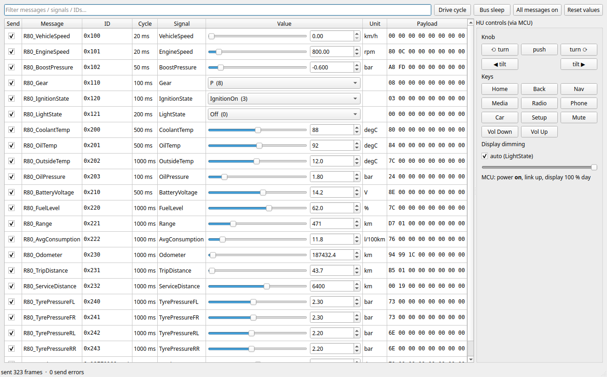

# hu-virtual: the R80 headunit without target hardware

Runs the headunit software on a Linux PC, with the car simulated by BoAt on
virtual CAN buses and the vehicle MCU replaced by an emulator process.

```
 BoAt (gateway :50061)                      "the headunit"
 ┌──────────────────────┐   vcan_info    ┌───────────────┐  UART (pty)  ┌──────────────┐  D-Bus   ┌────────────┐
 │ restbus.py  (R80 DBC)├───────────────►│ mcu_emu.py    ├─────────────►│ hu/vehicled  ├─────────►│ UI mockup  │
 │ tests/*.py           │   vcan_motor   │ power, knob,  │◄─────────────┤ DBC decode   │          │ (Sim.qml   │
 │ boat test run        │  (CAN 2, listen│ dimming, CAN  │              │ de.r80.Vehicle│         │  overlay)  │
 └──────────────────────┘   only)        └───────────────┘              └──────────────┘          └────────────┘
          ▲  mcuctl.py (knob, buttons, dim override) ────┘
 
 hu/mediad.py (GStreamer) ── D-Bus de.r80.Media ─────────────────────────────────►│ Media screen │
 ```

| Part | Real car / bench | Virtual |
|---|---|---|
| CAN buses | Motor, Infotainment, Comfort | `vcan_motor`, `vcan_info`, `vcan_comfort` (SocketCAN) |
| Rest of the car | real ECUs | BoAt gateway + `boat/restbus.py` playing `../hu-can/r80_test.dbc` |
| Vehicle MCU, CAN 1 active on Infotainment, CAN 2 listen-only (D8) | MCU on the HU board | `mcu_emu/mcu_emu.py` (same UART protocol), CAN 2 on `vcan_motor` by default |
| MCU ↔ Linux | UART, e.g. `/dev/ttyAMA0` | pty, symlinked at `$XDG_RUNTIME_DIR/r80-mcu-uart` |
| Knob / buttons | MCU pins | `mcu_emu/mcuctl.py` over a control socket |
| Linux vehicle service | `hu/vehicled.py --system --uart /dev/ttyAMA0` | `hu/vehicled.py` (session bus) |
| Linux media service | `hu/mediad.py --system --music-dir /media/usb` (GStreamer) | `hu/mediad.py` (session bus, demo tones unless `MUSIC_DIR` is set) |
| UI | Qt 6 / QML | `../hu-mockup`, with `hu/ui/qml/Sim.qml` swapped in |

Everything under `hu/` is target software and has no BoAt dependency; it runs
unchanged on the Pi. `mcu_emu/` and `boat/` exist only for the PC.

## Run it

Needs: [BoAt](https://github.com/AlexTech-stack/BoAt) built at `~/BoAt` (or `BOAT_ROOT=`), Python 3 with PySide6,
dbus-python, PyGObject and the GStreamer 1.0 bindings (`python3-gi` + `gst-plugins-base`/`-good`),
and `sudo` once to create the vcan buses. No cantools or python-can.

```bash
cd hu-virtual
./hu-virtual.sh drive      # buses, gateway, MCU emulator, vehicled, mediad, restbus drive cycle
./hu-virtual.sh ui         # the UI window on top (UI_ARGS="--fullscreen" etc.)
./hu-virtual.sh status
./hu-virtual.sh down
```

### Tester panel

```bash
./hu-virtual.sh up
./hu-virtual.sh panel      # instead of `drive`: the panel is the restbus
./hu-virtual.sh ui
```



`boat/restbus_panel.py` sends every message of `../hu-can/r80_test.dbc` through
the BoAt gateway at its cycle time, like `restbus.py`, and lets a tester:

- set any signal live: slider or spin box on the signal's own resolution, enums
  as drop-downs, with the resulting payload bytes shown per message,
- untick **Send** to drop one message (the HU flags it stale), or press
  **Bus sleep** to stop the whole bus (the MCU shuts the HU down),
- hand speed, rpm, gear, odometer, fuel, … to the **Drive cycle** and take them
  back; the other signals stay editable while it runs,
- operate the controls wired to the MCU: knob turn / push / tilt, the hard
  keys and the dimming override.

Ranges, enums and units come from the DBC itself (not from BoAt's PDU JSON,
whose min/max are wrong up to BoAt v0.1.1; AlexTech-stack/BoAt#11, fixed on master).

Poke it from the command line while it runs:

```bash
python3 mcu_emu/mcuctl.py knob 1           # turn (-1 = back)
python3 mcu_emu/mcuctl.py push
python3 mcu_emu/mcuctl.py button NAV       # HOME BACK NAV MEDIA RADIO PHONE CAR SETUP VOL_UP VOL_DOWN MUTE
python3 mcu_emu/mcuctl.py dim 30           # or "auto"
python3 mcu_emu/mcuctl.py status
gdbus call --session -d de.r80.Vehicle -o /de/r80/Vehicle \
  -m org.freedesktop.DBus.Properties.GetAll de.r80.Vehicle1
candump -a vcan_info
RESTBUS_ARGS="--lights LowBeam" ./hu-virtual.sh restbus   # night mode (stop the drive one first)
MCU_CAN2=vcan_comfort MCU_CAN2_BUS=comfort ./hu-virtual.sh up   # CAN 2 on Comfort instead of Motor
```

The UI falls back to the mockup's own fake data whenever hu-vehicled or the
MCU link is not there, so `run_hu.py` also works on its own.

## Media (hu-mediad)

`hu/mediad.py` is the Linux media service: it scans a folder for audio files
(the USB / SD-card source) and plays them with GStreamer `playbin`, publishing
on D-Bus `de.r80.Media` at `/de/r80/Media` (interface `de.r80.Media1`):

- properties `PlaybackStatus`, `Source`, `Sources`, `TrackIndex`, `TrackCount`,
  `Position` (µs), `Metadata`, `Playlist`, `Shuffle`, `RepeatAll`, `CanGoNext`,
  `CanGoPrevious`
- methods `Play`, `Pause`, `PlayPause`, `Next`, `Previous`, `SetTrack`, `Seek`,
  `SetPosition`, `SetPlaying`, `SetShuffle`, `SetRepeatAll`, `SetSource`,
  `SetGain` (the playback level, set by hu-audiod)
- signals `Seeked` and `PropertiesChanged`

`./hu-virtual.sh up` starts it on a demo folder of short WAV tones. Point it at
your own library with `MUSIC_DIR` (then no tones are written), or pass extra
flags with `MEDIA_ARGS`:

```bash
MUSIC_DIR=~/Music ./hu-virtual.sh up
MEDIA_ARGS="--music-dir /media/usb --sink fakesink" ./hu-virtual.sh up
gdbus call --session -d de.r80.Media -o /de/r80/Media -m de.r80.Media1.Next
gdbus call --session -d de.r80.Media -o /de/r80/Media \
  -m org.freedesktop.DBus.Properties.Get de.r80.Media1 Metadata
```

Title / artist come from the file name (`Artist - Title.ext`), the album from
the folder, and the duration is learned once GStreamer prerolls the track.
Bluetooth A2DP and MPRIS are not wired up yet. `hu/ui/qml/Sim.qml` binds the
Media screen to this service and falls back to the mockup's own playlist when
`hu-mediad` is not on the bus, so `run_hu.py` still works alone.

## Audio (hu-audiod)

`hu/audiod.py` owns volume and mute (decision D9), on D-Bus `de.r80.Audio` at
`/de/r80/Audio` (interface `de.r80.Audio1`):

- properties `Max`, `Master`, `Muted`, `StartupCap`, `Volumes` (per source:
  media, navigation, phone, radio), `Gains` (the level each source should play at)
- methods `SetMaster`, `Step`, `SetMuted`, `ToggleMute`, `SetVolume(source, value)`

For each source it computes `gain = ((Master / Max) * (Volume / Max)) ** curve`
(0 while muted) and the source applies it itself: `mediad` through `SetGain`,
with a GStreamer `volume` element, so PipeWire's own stream volume is never
touched. The MCU's VOL_UP / VOL_DOWN / MUTE keys go straight to audiod (ignored
while the HU is off); the UI only shows the master volume and asks audiod to
change it.

The numbers are in `hu/audio.ini` (overridden by `/etc/r80/audio.ini`, then
`--config`); audiod refuses to start on a bad value. The volumes themselves are
state: `hu-virtual.sh` keeps them in `$XDG_RUNTIME_DIR/r80-hu/audio-state.json`
(default elsewhere: `~/.local/state/r80/audio.json`), and the master volume is
capped at `startup_cap` when audiod starts. Extra flags go in `AUDIO_ARGS`.

```bash
gdbus call --session -d de.r80.Audio -o /de/r80/Audio -m de.r80.Audio1.SetMaster 15
gdbus call --session -d de.r80.Audio -o /de/r80/Audio \
  -m org.freedesktop.DBus.Properties.GetAll de.r80.Audio1
```

Not yet: ducking for navigation prompts and the call rules (step 2), and the
volume UI on every screen and in Settings → Audio (step 3).

## Tests (BoAt)

```bash
./hu-virtual.sh up
./hu-virtual.sh test       # boat test run boat/manifest_hu_smoke.json, reports in $XDG_RUNTIME_DIR/r80-hu/reports
```

| ID | Checks |
|---|---|
| TC_HU_001 | restbus values arrive decoded on D-Bus: signed, offset, enum, 32-bit, the 29-bit ID |
| TC_HU_002 | a missing message is flagged in `StaleSignals` and recovers |
| TC_HU_003 | on / acc / standby from IgnitionState, bus sleep → shutdown handshake → off, wake-up |
| TC_HU_004 | day/night from LightState, MCU dim override |
| TC_HU_005 | knob and button events reach D-Bus in order |
| TC_HU_006 | HU can send on Infotainment, never on Motor or Comfort (checked on the wire by BoAt) |
| TC_HU_007 | media play / pause: `PlaybackStatus` follows the player, position runs or stands still, metadata matches |
| TC_HU_008 | media tracks: SetTrack, Next/Previous (restart after 3 s), wrap-around, stop at the end without repeat, seek |
| TC_HU_009 | audio: master / source volume and mute reach mediad's gain, values from `audio.ini`, MCU VOL_UP / VOL_DOWN / MUTE |
| TC_HU_010 | audio: volumes saved to the state file, master capped at startup (audiod's own startup logic on that file; no real restart) |

Each test starts its own `Restbus` from Python (`from restbus import Restbus`),
so stop the drive-cycle node first (`./hu-virtual.sh test` does that).

CI runs these tests on every push (job `boat-sil`) with `../ci/run_boat_sil.sh --install`:
the BoAt release pinned in `../ci/boat.version`, a private D-Bus session, and
reports plus logs uploaded as the `boat-reports` artifact. Run the same thing
locally with `../ci/run_boat_sil.sh` (your BoAt) or with `--install` (the pinned
one, under `build/ci-boat/`). The verdict is the exit code of `boat test run`;
BoAt's `report.junit.xml` is empty for script tests (AlexTech-stack/BoAt#50).
`BOAT_VERSION=master ../ci/run_boat_sil.sh --install` tests against BoAt master
(gateway from BoAt's CI image); the nightly `boat-canary` workflow does that too.
BoAt runs on the x86_64 test PC only; on the bench the Raspberry Pi is the DUT and
runs `mcu_emu/` and `hu/` (see `../docs/bench-pi.md`), so `--install` refuses other machines.

`../ci/run_boat_sil.sh --dut-arch=arm64` keeps that split on one x86 machine: BoAt on
the host (`HU_DUT=external ./hu-virtual.sh up` starts only the buses and the gateway),
the DUT (`mcu_emu/`, `vehicled`, `mediad`) in an aarch64 Debian 13 container under QEMU
(`../ci/dut/`). `--dut-arch=amd64` does the same with an x86 container, in case the final
hardware is x86. Both share the host's vcan buses, `$XDG_RUNTIME_DIR` and a private
session bus, so the tests run unchanged. CI runs both as the job `boat-sil-dut`.
`run_boat_sil.sh` passes `MEDIA_ARGS=--sink fakesink`, so test runs stay silent.
It refuses to run (exit 2) while an environment is already up here (live services
in `$XDG_RUNTIME_DIR/r80-hu` or anything on the gateway port), so it never tests
against, or shuts down, a session someone is using.

## Files

```
hu-virtual.sh            start/stop everything, run tests
build/                   git-ignored; the BoAt PDU database made from ../hu-can/r80_test.dbc
                         (tools/dbc2boatjson.py --bus Infotainment), rebuilt when the DBC changes
hu/mcu_link.py           MCU <-> Linux UART protocol (framing, message types)
hu/dbc.py                small DBC decoder/encoder, no dependencies
hu/vehicled.py           Linux vehicle service: UART -> DBC -> D-Bus de.r80.Vehicle
hu/mediad.py             Linux media service: GStreamer playbin -> D-Bus de.r80.Media
hu/audiod.py             Linux audio service: volume, mute -> D-Bus de.r80.Audio, gain to mediad
hu/audio.ini             audiod's numbers (scale, startup cap, defaults, curve)
hu/ui/run_hu.py          UI launcher: mockup + Sim.qml overlay + MCU key input + power blanking
hu/ui/backend.py         QML singletons `Vehicle` and `Media` (R80.Backend 1.0) mirroring D-Bus
hu/ui/qml/Sim.qml        mockup's Sim.qml with vehicle values bound to `Vehicle`
mcu_emu/mcu_emu.py       MCU emulator
mcu_emu/mcuctl.py        control client (also used by the tests)
boat/restbus.py          BoAt restbus node / library
boat/restbus_panel.py    tester GUI: the restbus with live signal editing + HU controls
boat/env_hu_virtual.json BoAt test environment (gateway started by hu-virtual.sh)
boat/manifest_hu_smoke.json
boat/tests/              the six tests
docs/                    screenshots: the UI on live CAN data, the tester panel
```

## Assumptions to check

- **The MCU link protocol is a placeholder** (`hu/mcu_link.py`: HDLC-style
  framing, CRC-16, message types for CAN, power, input, dimming). Architecture
  v0.3 names the link "SPI/UART" but doesn't define a protocol yet; all framing
  lives in that one file.
- The whole test DBC is put on the Infotainment bus (as if the car's gateway
  routes it there). Motor and Comfort are up but idle; the emulator's CAN 2
  listens on one of them and only forwards its frames with `--forward-can2`.
- Power: no Infotainment traffic for 2 s = bus asleep; Linux gets 10 s to
  answer SHUTDOWN_READY. Night = LowBeam or HighBeam, night level 40 %.
- D-Bus property names are the DBC signal names; `backend.py` maps them to the
  mockup's names (`VehicleSpeed` → `speed`, `FuelLevel` % → `fuelLevel` 0..1, …).
- **Media is local files only for now.** `hu/mediad.py` plays a folder with
  GStreamer; Bluetooth A2DP, MPRIS, tag parsing and cover art are not implemented
  yet. Metadata comes from the file name and folder.

## BoAt notes

The four BoAt issues found while building this (see BoAt's
`test/foundIssues.md`) are fixed in BoAt `58a0b8c`. What is left here from the
workarounds:

- The gateway is still started by `hu-virtual.sh`, not by the test runner, so
  the same gateway serves the drive cycle, the UI and the tests.
- The restbus paces its frames itself through `FrameService.SendFrame`. Since
  `58a0b8c`, cyclic PDU routes in `pdu_router` would also work (a `send()` only
  updates the payload), so the restbus could move to them later.
